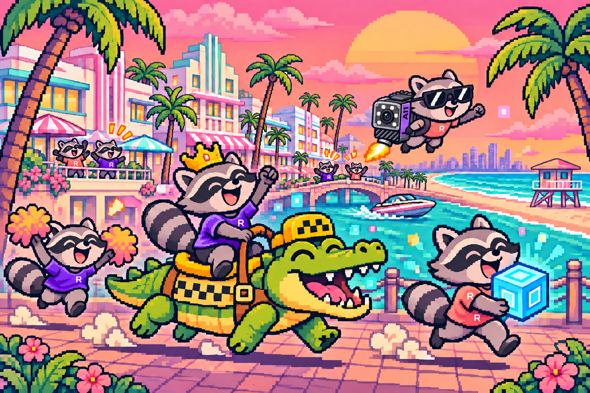

# Roboflow Killer Queen — Lenny’s Miami Mayhem

A multiplayer browser arcade with Miami pixel art, Roboflow-themed raccoons, AI1 upgrade stations, and a crocodile getaway. Play Classic with up to 10 players or explore a scrolling XXL city with up to 120. The interface is in English.

**[Play online](https://roboflow-killer-queen.up.railway.app/)**



## Run on your laptop

Requires Node.js 22 or newer.

```sh
npm ci
npm start
```

Open **http://localhost:8787**. On macOS, you can also open `Start Miami Mayhem.command`.

For development with automatic server restarts:

```sh
npm run dev
```

## Play on a local network

The server listens on `0.0.0.0`. Friends on the same network should open the **LAN address printed in the terminal**, create or join a room, and use the same room code. The host must keep the server running and allow incoming TCP connections on port 8787. Guest Wi-Fi/client isolation can prevent devices from reaching each other.

The home page’s **Play on your network** button lists LAN addresses. Invitations use the address currently open in your browser: `localhost` only works on the host laptop, so open the LAN address before copying an invitation for friends.

Change the port with `PORT=9000 npm start`. Local and hosted servers have independent rooms.

## Rooms and teams

- Home offers **Create a room** and **Join a room**, an editable player name, and open rooms.
- A short controls/objectives guide appears before joining.
- The lobby shows both teams, participant names, humans and bots, roles, vacancies, and the room leader. Use **Join Purple / Join Sunset** to switch teams before the round.
- Only the leader can start. Each side needs at least one participant and its Queen roles filled; a full room is not required. A three-second countdown gives everyone the same start.
- Classic has 5 slots per side; XXL has 60. Joining a full side can replace a bot, never another human.
- Choose **Queen** or **Worker** before the round. Each team has `ceil(team size / 5)` Queen seats, including bots. Warriors are earned during play.
- Choose 0–9 bots in Classic or 0–119 in XXL, with **Easy**, **Normal**, or **Hard** difficulty. The leader can change these in the lobby or between rounds.
- Unlisted rooms are accessible by their invitation/code. Room codes are invitations, not authenticated accounts.

## Three ways to win

1. **Economic:** workers carry one Roboflow chip at a time from finite supply piles to their own HQ doorway. The team target is `ceil(12 × total participants / 10)`, counting humans and bots. That is 12 chips per team at 10 players, 24 at 20, and 144 at 120. Total arena stock is six chips per participant. Targets are fixed when the round begins.
2. **Military:** eliminate every opposing Queen’s three lives. A defeated Warrior returns as a Worker; Workers have unlimited respawns.
3. **Gator:** a Worker rides the crocodile to their team’s goal. Enemies can defeat the rider and take it back.

Workers can spend a carried chip at a neutral or friendly AI1 station to gain Warrior wings or speed. Queens claim stations by touching them. Upgrading requires remaining still inside the machine. Queens and Warriors cannot collect chips or ride the crocodile.

The Classic arena is 1,440 × 820, with grouped stockpiles, elevated HQs and a mirrored zig-zag climb. Workers must travel between supplies and the vault instead of repeating a short local loop. An uninterrupted crocodile ride from center takes 70 seconds, or about 47 seconds with an earned speed upgrade. A limited number of armed bots respond to opponents nearing an economic or gator victory; Queens retreat from unsafe fights and nearby warriors can protect a threatened Queen. XXL is 12,000 × 2,000 with a following camera. Player bodies do not create walls: teammates can pass through one another, and armed enemy contact uses combat rules.

See [pacing changes and measured match samples](docs/BALANCE.md).

## Controls

| Action                             | Keyboard                     |
| ---------------------------------- | ---------------------------- |
| Move                               | A / D or left / right arrows |
| Jump; hold to fly as Queen/Warrior | Space / W / up arrow         |
| AI1 station or crocodile           | E / J                        |
| Queen dive / drop through platform | S / down; Shift also dives   |
| Role guide                         | R                            |
| Crew names and scores              | Hold Tab                     |
| Menu                               | Escape                       |

Mobile supports portrait and landscape, with a right movement stick and left Jump/Action buttons. Fullscreen and screen wake lock are optional browser capabilities. Touch controls can be set to Auto, Always on, or Off. The game uses a following camera on small Classic viewports so characters stay readable.

Pinch and double-tap page zoom are suppressed across home, menus, lobby and gameplay; single-finger scrolling remains available outside gameplay. Browser or OS accessibility overrides may still apply. Automated and desktop touch-simulation checks are available; this is not certification of every physical phone/browser combination.

Player labels default to your character and nearby humans. **All / Hide** preferences and the crew panel provide other name displays. The compact activity feed identifies pickups, deliveries and knockouts.

## Host online

This is a Node HTTP + WebSocket server, not a static website. Run one process/replica behind HTTPS with WebSocket upgrades forwarded for `/ws`. Rooms are in memory and reset when the process restarts; multiple replicas require shared room routing/state that this project does not implement.

```sh
docker compose up -d --build
```

The Docker image uses Node 24, runs as a non-root user, reads `PORT`, and provides `/api/health`. Set `PUBLIC_HOSTED=1` on a public host to hide local LAN addresses from the network dialog.

For Railway, deploy this repository using the included Dockerfile, enable a public domain, set `PUBLIC_HOSTED=1`, configure `/api/health`, and keep one replica. With the official Railway CLI linked to the intended service, `railway up` deploys local changes. The existing live game is in US East (Virginia); choose a region based on actual player latency.

For temporary testing, if Cloudflare’s `cloudflared` CLI is already installed, run `npm run internet` alongside the local server. The generated URL changes when restarted and depends on the laptop staying online.

## Test and measure

```sh
npm test
node scripts/internet-smoke.mjs http://localhost:8787
node scripts/bot-balance-benchmark.mjs normal
node scripts/pacing-benchmark.mjs --help
node scripts/pacing-benchmark.mjs natural
npm run loadtest
```

The test suite covers physics, navigation, economic scaling, lobby authorization/team capacity, bot decisions, combat, touch input, gestures, and network state. GitHub Actions runs it on Node 22 and 24.

The balance benchmark runs real server matches with ordinary bots and passive test clients. It records outcomes and delivery timing; synthetic matches are samples, not promises of human match duration. Load tests are intended for a local or controlled staging server. A 120-slot configuration does not establish capacity on every host or network.

## Source layout

- `server.js`: authoritative simulation, rooms, bots, HTTP and WebSockets.
- `shared/`: physics, maps, navigation, protocol, input buffering and lobby rules.
- `public/`: browser rendering, menus, mobile controls, pixel assets and fonts.
- `test/`: Node test suite.
- `scripts/`: network, load and balance measurement tools.

No build step or database is required. Local session metadata, deployment credentials, generated test reports and `node_modules` are excluded from Git. Bundled fonts retain their license files. This is a fan-made arcade adaptation with custom XXL rules, not the original Killer Queen game.
